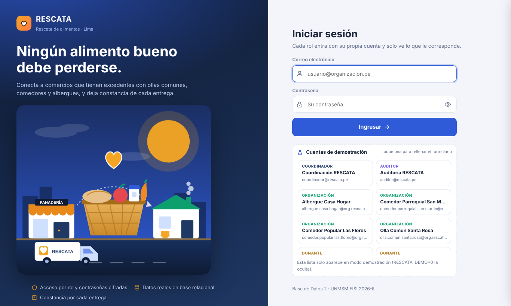
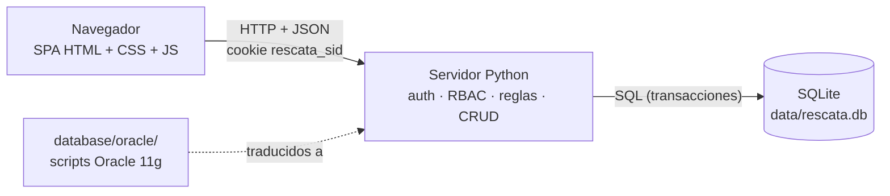
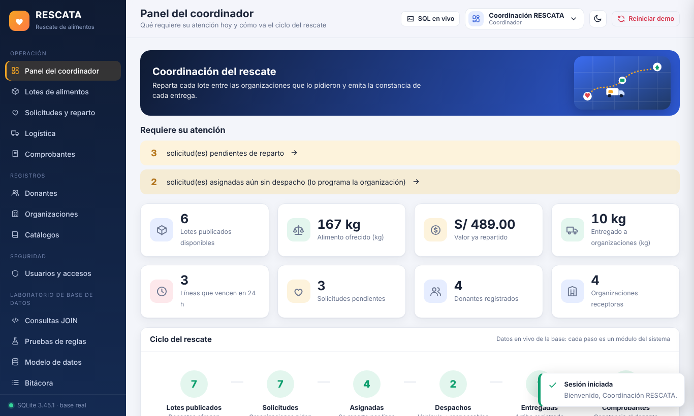
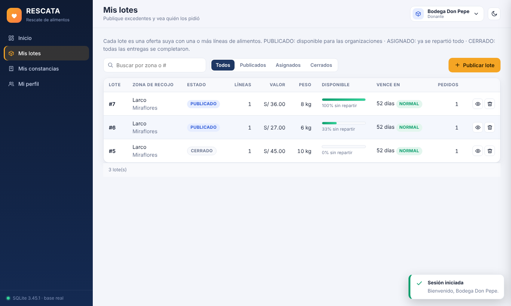
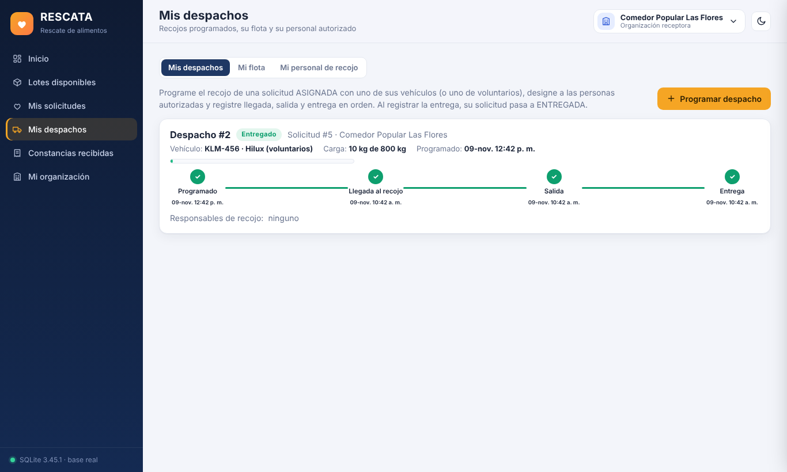
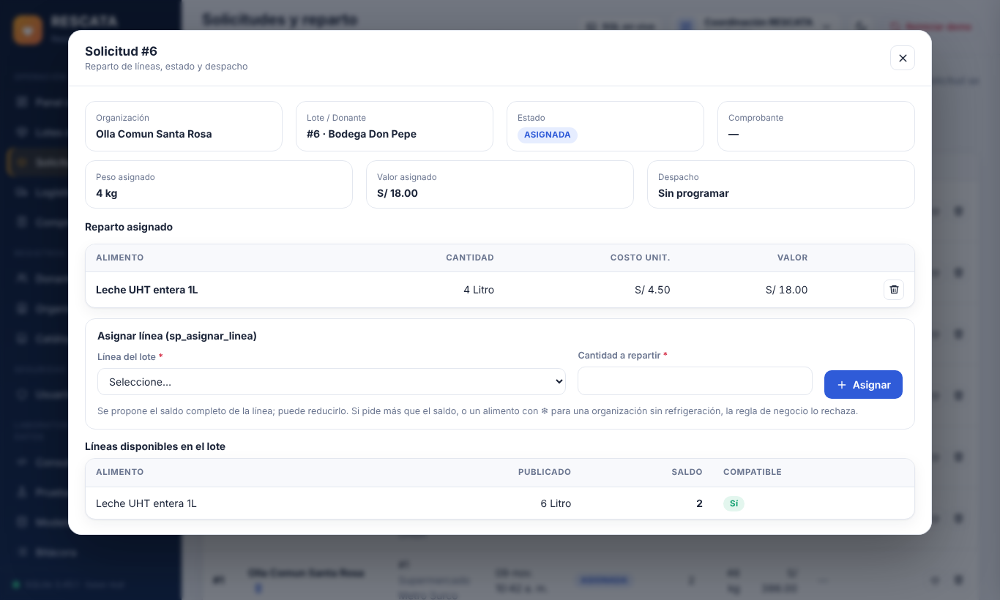
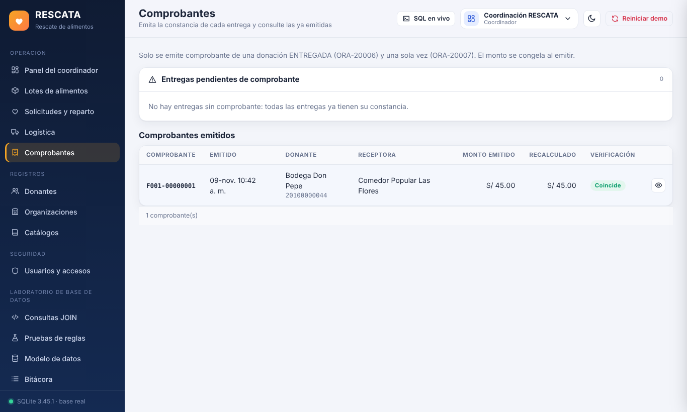
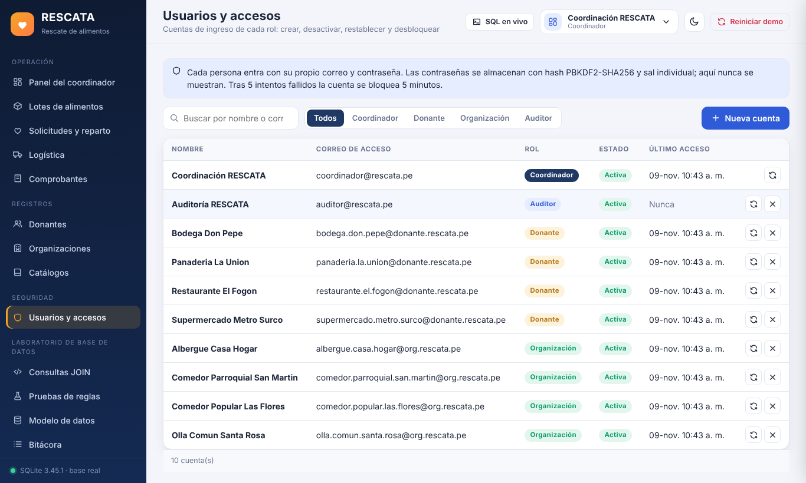
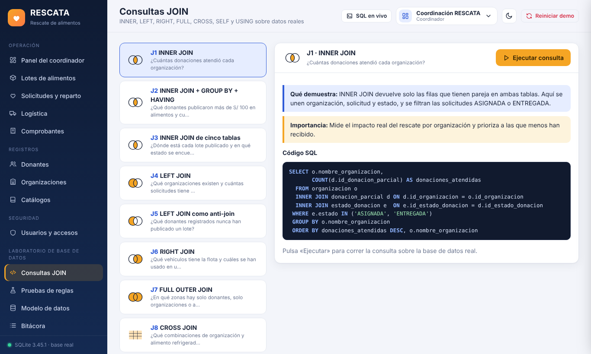
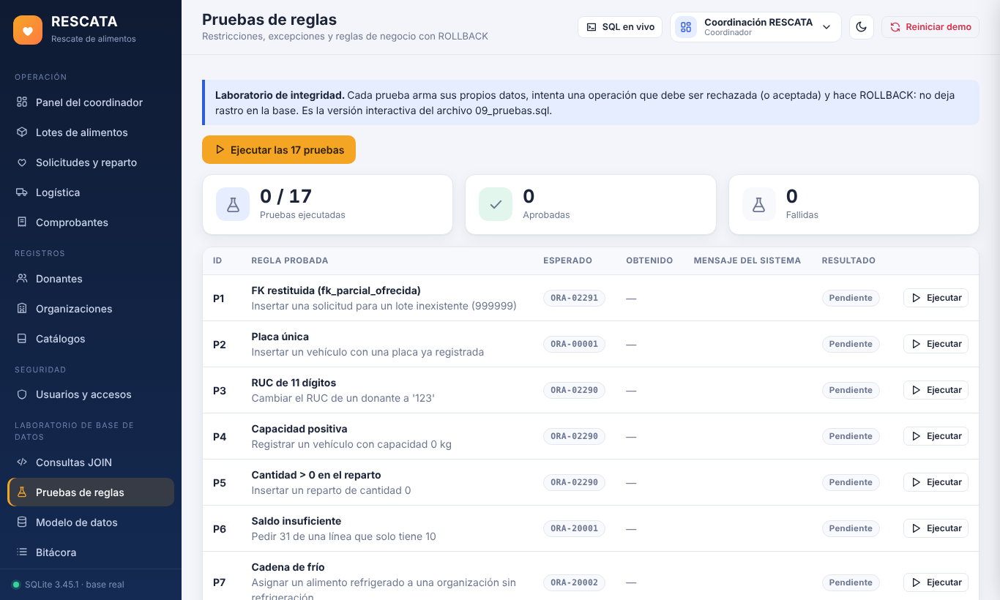

<div align="center">

# 🥖 RESCATA

**Sistema web de rescate y redistribución de alimentos excedentes**

Conecta a comercios que tienen alimentos aptos para el consumo con ollas comunes, comedores y albergues, y deja constancia de cada entrega.




</div>

## Descripción general

RESCATA es una aplicación web completa (frontend, backend y base de datos relacional) desarrollada como proyecto del curso **Base de Datos 2** (UNMSM – Facultad de Ingeniería de Sistemas e Informática, 2026-II). Modela todo el ciclo de un rescate de alimentos: el **donante publica** un lote, la **organización lo solicita**, el **coordinador reparte** los alimentos, la organización **recoge** (con hitos de llegada, salida y entrega) y el sistema **emite un comprobante** de donación.

Las reglas de negocio (saldos, cadena de frío, comprobante único) y las consultas JOIN provienen de los scripts Oracle 11g del proyecto (`database/oracle/`, modelo de 21 tablas del 3.er avance). La aplicación ejecutable los traduce a SQLite y Python para poder demostrarse en cualquier computadora sin instalar nada, y su modelo es de 22 tablas porque incorpora la tabla `vehiculo` (en los scripts Oracle el vehículo es una columna de texto del despacho).

## Problemática identificada

Comercios y empresas generan excedentes de alimentos que aún son aptos para el consumo, mientras organizaciones comunitarias necesitan alimentos y carecen de un canal ordenado para recibirlos. Sin un sistema, la coordinación depende de llamadas y mensajes dispersos, no se conoce el saldo real de cada lote, se corre el riesgo de entregar alimentos refrigerados a quien no tiene frío o de superar la capacidad del vehículo, y no queda evidencia verificable de lo entregado.

## Objetivos

**General.** Desarrollar un sistema de información que gestione de forma segura y trazable la publicación, el reparto, el transporte y la constancia de donaciones de alimentos excedentes.

**Específicos.**
1. Modelar el dominio en una base de datos relacional normalizada de 22 tablas con integridad garantizada por la propia base (PK, FK, UNIQUE, CHECK y disparador).
2. Implementar las reglas de negocio del reparto y la logística con códigos de error trazables (`ORA-20001…20017`).
3. Ofrecer un acceso por rol (coordinador, donante, organización, auditor) con autenticación segura y control de acceso en backend y frontend.
4. Permitir comprobar el funcionamiento de la base mediante 10 consultas JOIN, 17 pruebas de reglas y un panel de SQL en vivo.
5. Documentar y probar el sistema de modo que pueda reproducirse desde cero.

## Alcance

**Incluye:** autenticación y gestión de cuentas; publicación y consulta de lotes; solicitudes; reparto de alimentos con validación de saldo y frío; despachos con vehículos, personal y hitos; comprobantes; mantenimiento de donantes, organizaciones y catálogos; paneles con indicadores; laboratorio de base de datos; bitácora.

**No incluye (por ahora):** HTTPS, recuperación de contraseña por correo, doble factor, conexión directa a Oracle, exportación de reportes ni notificaciones. Ver [estado actual](#estado-actual-del-desarrollo).

## Funcionalidades principales

| Área | Funcionalidad |
|---|---|
| Seguridad | Login por correo y contraseña (PBKDF2-SHA256 + sal), sesión HttpOnly con caducidad, bloqueo por intentos, cambio de contraseña, RBAC y alcance por cuenta, defensa CSRF, CSP |
| Donaciones | Publicación de lotes con varias líneas en una transacción, saldos por línea, alertas de vencimiento |
| Reparto | Asignación manual con validación, sugerencia de receptoras, reparto equitativo, estado de la solicitud derivado |
| Logística | Despachos con control de capacidad, hitos ordenados, flota y personal por organización |
| Comprobantes | Emisión única por entrega, monto congelado y verificación contra el recálculo |
| Administración | CRUD validado de donantes, organizaciones, catálogos y usuarios |
| Laboratorio BD | 10 consultas JOIN, 17 pruebas de reglas con `ROLLBACK`, explorador del modelo, consola SQL de solo lectura, **SQL en vivo** |
| Experiencia | Diseño responsive, tema claro/oscuro, ilustraciones propias, animaciones sutiles |

## Tecnologías utilizadas

| Capa | Tecnología |
|---|---|
| Backend | Python 3.9+ · `http.server` (ThreadingHTTPServer) · `sqlite3` · `hashlib`/`hmac`/`secrets` — **solo biblioteca estándar** |
| Base de datos | SQLite (WAL, claves foráneas activas) · scripts Oracle 11g de referencia |
| Frontend | HTML5 · CSS3 (variables, grid, tema claro/oscuro) · JavaScript ES Modules sin frameworks · gráficos SVG/CSS · ilustraciones SVG propias |
| Pruebas | `unittest` (39 pruebas) · Playwright para la prueba E2E opcional |

## Arquitectura del sistema



Detalle en [docs/arquitectura.md](docs/arquitectura.md).

## Roles de usuario

| Rol | Puede | No puede |
|---|---|---|
| **Coordinador** | Repartir lotes, supervisar logística, emitir comprobantes, administrar donantes/organizaciones/catálogos/usuarios, ver SQL en vivo, reiniciar la demo | Crear solicitudes (las crea la organización) ni cambiar estados a mano |
| **Donante** | Publicar, consultar y eliminar **sus** lotes; ver quién los pidió y sus constancias; editar su perfil | Ver datos de otros donantes ni repartir |
| **Organización** | Pedir lotes, programar y registrar recojos, gestionar **su** flota y personal, ver sus constancias | Asignar alimentos, emitir comprobantes, ver pedidos ajenos |
| **Auditor** | Ver comprobantes, consultas, pruebas, modelo y bitácora (solo lectura) | Modificar cualquier dato |

Matriz completa de permisos en [docs/seguridad.md](docs/seguridad.md).

## Estructura del proyecto

```
rescata-rescate-alimentos/
├── backend/                 Servidor y lógica (Python, solo stdlib)
│   ├── server.py            HTTP, rutas, matriz de permisos y alcance por cuenta
│   ├── auth.py              Hash de contraseñas, sesiones, bloqueo
│   ├── business.py          Procedimientos y funciones de negocio (sp_* / fn_*)
│   ├── reglas.py            17 pruebas de reglas con ROLLBACK
│   ├── queries.py           10 consultas JOIN y consola SQL de solo lectura
│   ├── crud.py · services.py · database.py · errors.py · config.py
├── frontend/                Aplicación de página única
│   ├── index.html · css/styles.css
│   ├── js/ (app.js, api.js, ui.js, state.js, icons.js, pages/*.js)
│   └── assets/ (img/*.svg, modelo_22_*.png)
├── database/
│   ├── schema.sql · seed.sql · auth.sql        Base SQLite
│   └── oracle/                                 Scripts Oracle 11g originales
├── tests/                   test_rescata.py · test_roles.py · test_auth.py · e2e/
├── docs/                    Documentación técnica, manual y capturas
├── .env.example · .gitignore · run.sh · run.bat
└── README.md
```

## Requisitos previos

* **Python 3.9 o superior** (nada más: no hay paquetes que instalar).
* Un navegador actual. *(Opcional, solo prueba E2E: Node.js 18+).*

## Instalación y ejecución

```bash
git clone https://github.com/Rony-Grijalva/rescata-rescate-alimentos.git
cd rescata-rescate-alimentos
cp .env.example .env          # opcional
python3 backend/server.py     # Windows: py -3 backend\server.py  o doble clic en run.bat
```

Abre `http://127.0.0.1:8000`. Guía completa: [docs/instalacion.md](docs/instalacion.md) · despliegue: [docs/despliegue.md](docs/despliegue.md).

## Configuración de la base de datos

No hay nada que configurar: en el primer arranque se crea `data/rescata.db` ejecutando `database/schema.sql` (22 tablas del modelo más `bitacora`, 13 índices, 4 vistas, 1 disparador), `database/seed.sql` (datos de ejemplo) y `database/auth.sql` (usuarios y sesiones). Para empezar de cero, borre `data/rescata.db` o use **Reiniciar demo**. Documentación del modelo: [docs/base-de-datos.md](docs/base-de-datos.md).

### Credenciales de demostración

La pantalla de ingreso lista las cuentas de ejemplo (`RESCATA_DEMO=1`) y las rellena con un toque. La contraseña inicial de todas las cuentas de demostración se define en `RESCATA_DEMO_PASSWORD` (variable de entorno o `.env`; si no se define se usa el valor de demostración documentado en `backend/auth.py`). **Cámbiela** desde el menú de usuario.

| Rol | Correo de ejemplo |
|---|---|
| Coordinador | `coordinador@rescata.pe` |
| Auditor | `auditor@rescata.pe` |
| Donante | `bodega.don.pepe@donante.rescata.pe` |
| Organización | `comedor.popular.las.flores@org.rescata.pe` |

## Pruebas

```bash
python3 -m unittest discover -s tests -v      # 39 pruebas: reglas de negocio, roles y autenticación
```

## Capturas de pantalla

| Coordinador | Donante |
|---|---|
|  |  |
| **Organización** | **Gestión del reparto** |
|  |  |
| **Comprobantes** | **Usuarios y accesos** |
|  |  |
| **Consultas JOIN** | **Pruebas de reglas** |
|  |  |

Más capturas y el paso a paso por rol en el [manual de usuario](docs/manual-usuario.md).

## Documentación

| Documento | Contenido |
|---|---|
| [arquitectura.md](docs/arquitectura.md) | Componentes y flujo de una petición |
| [base-de-datos.md](docs/base-de-datos.md) | Tablas, claves, vistas, reglas y scripts Oracle |
| [api.md](docs/api.md) | Endpoints, permisos y formato de respuestas |
| [seguridad.md](docs/seguridad.md) | Autenticación, RBAC, protecciones y limitaciones |
| [instalacion.md](docs/instalacion.md) · [despliegue.md](docs/despliegue.md) | Puesta en marcha |
| [manual-usuario.md](docs/manual-usuario.md) | Uso por rol, con capturas |
| [avances.md](docs/avances.md) | Etapas, módulos, correcciones y pendientes |

## Estado actual del desarrollo

Todos los módulos descritos están implementados y probados (39 pruebas unitarias y una prueba E2E con navegador real). Pendiente: HTTPS, recuperación de contraseña, doble factor, integración continua, exportación de reportes y conexión directa a Oracle. Ver [avances.md](docs/avances.md).

## Autores y créditos

Proyecto académico del curso **Base de Datos 2**, UNMSM – FISI, 2026-II. Docente: **Juan Tapia**.

Equipo: Augusto Nicolás Cerna Sifuentes · Jeremy Alexander Duran Obeso · Josué Martines Cancho · Pedro Fernando Yanyachi Perez · Rony Smith Grijalva de la Cruz.

Repositorio publicado por [Rony-Grijalva](https://github.com/Rony-Grijalva). Las ilustraciones son dibujos vectoriales propios incluidos en `frontend/assets/img/`.
