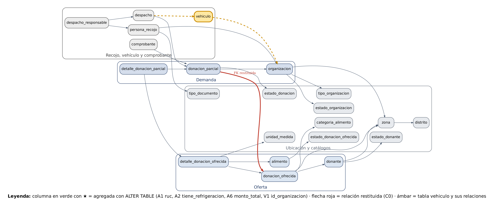

# Base de datos

Motor: **SQLite** (WAL, `foreign_keys=ON`). El modelo es la traducción de los scripts Oracle 11g del proyecto (`database/oracle/`): `IDENTITY` → `AUTOINCREMENT`, `NVL` → `IFNULL`, PL/SQL → Python (`backend/business.py`).

Archivos: `database/schema.sql` (modelo + índices + vistas + disparador), `database/seed.sql` (datos de ejemplo) y `database/auth.sql` (autenticación). Total: **22 tablas del modelo + `bitacora` + `usuario` + `sesion` = 25 tablas**.

## Tablas del modelo

| Tabla | Columnas (PK*) | Claves foráneas |
|---|---|---|
| `distrito` | id_distrito*, nombre_distrito, provincia | — |
| `zona` | id_zona*, id_distrito, nombre_zona | id_distrito → distrito |
| `categoria_alimento` | id_categoria_alimento*, nombre_categoria | — |
| `alimento` | id_alimento*, nombre_alimento, id_categoria_alimento, requiere_refrigeracion | id_categoria_alimento → categoria_alimento |
| `unidad_medida` | id_unidad_medida*, tipo_medida | — |
| `tipo_documento` | id_tipo_documento*, tipo_doc | — |
| `tipo_organizacion` | id_tipo_organizacion*, tipo | — |
| `estado_donante` / `estado_organizacion` / `estado_donacion_ofrecida` / `estado_donacion` | id*, estado | — |
| `donante` | id_donante*, nombre_donante, direccion, id_zona, telefono, email, id_estado_donante, ruc | id_zona → zona; id_estado_donante → estado_donante |
| `organizacion` | id_organizacion*, nombre_organizacion, direccion, id_zona, fecha_habilitacion, id_estado_organizacion, id_tipo_organizacion, tiene_refrigeracion | id_zona, id_estado_organizacion, id_tipo_organizacion |
| `persona_recojo` | id_persona_recojo*, id_organizacion, nombres, apellidos, id_tipo_documento, num_documento, sexo, telefono, email | id_organizacion, id_tipo_documento |
| `vehiculo` | id_vehiculo*, placa, marca, modelo, capacidad_kg, id_organizacion | id_organizacion → organizacion |
| `donacion_ofrecida` (lote) | id_donacion_ofrecida*, id_donante, fecha_publicacion, id_estado_donacion_ofrecida, direccion, id_zona | id_donante, id_zona, id_estado_donacion_ofrecida |
| `detalle_donacion_ofrecida` (línea del lote) | id_detalle_donacion_ofrecida*, id_donacion_ofrecida, id_alimento, marca, codigo_lote, fecha_vencimiento, cantidad, id_unidad_medida, peso_total_kg, costo_unitario | id_donacion_ofrecida, id_alimento, id_unidad_medida |
| `donacion_parcial` (solicitud) | id_donacion_parcial*, id_donacion_ofrecida, id_organizacion, fecha_solicitud, id_estado_donacion | id_donacion_ofrecida, id_organizacion, id_estado_donacion |
| `detalle_donacion_parcial` (reparto) | id_detalle_donacion_parcial*, id_donacion_parcial, id_detalle_donacion_ofrecida, cantidad | id_donacion_parcial, id_detalle_donacion_ofrecida |
| `despacho` | id_despacho*, id_donacion_parcial, id_vehiculo, fecha_programada, fecha_llegada, fecha_salida, fecha_arribo | id_donacion_parcial, id_vehiculo |
| `despacho_responsable` | id_despacho_responsable*, id_despacho, id_persona_recojo | id_despacho, id_persona_recojo |
| `comprobante` | id_comprobante*, id_donacion_parcial, serie, numero, fecha_emision, monto_total | id_donacion_parcial |

## Tablas de la aplicación

| Tabla | Propósito |
|---|---|
| `bitacora` | id_bitacora*, fecha, rol, accion, entidad, detalle, resultado — auditoría de operaciones, incluidas las rechazadas. |
| `usuario` | id_usuario*, email (único, sin distinguir mayúsculas), nombre, `password_hash`, rol (`admin`/`donante`/`organizacion`/`auditor`), id_donante, id_organizacion, activo, intentos_fallidos, bloqueado_hasta, ultimo_acceso, creado. Un `CHECK` impone que un donante tenga `id_donante`, una organización `id_organizacion` y admin/auditor ninguno. FK con `ON DELETE CASCADE`. |
| `sesion` | token_hash* (SHA-256 del token), id_usuario, creada, ultima_actividad, expira. |

## Vistas, índices y disparador

* Vistas: `v_saldo_linea`, `v_lotes_disponibles`, `v_demanda_organizacion`, `v_comprobante_valorizado`.
* Disparador: `trg_det_parcial_saldo` — impide repartir más que el saldo de una línea (traducción del trigger Oracle).
* 13 índices (`ix_*`) sobre claves foráneas y campos de búsqueda frecuente.

## Reglas de integridad y de negocio

| Código | Regla | Dónde se aplica |
|---|---|---|
| ORA-00001 | Valor único duplicado (placa, correo) | UNIQUE |
| ORA-02290 | CHECK (RUC de 11 dígitos, capacidad > 0, cantidad > 0, orden cronológico del despacho) | CHECK |
| ORA-02291 / ORA-02292 | FK inexistente / no se borra un padre con hijos | FK |
| ORA-20001 | Saldo insuficiente | `sp_asignar_linea` + disparador |
| ORA-20002 | Alimento refrigerado a organización sin refrigeración | `sp_asignar_linea` |
| ORA-20003 / 20005 | Línea de otro lote / línea ya asignada | `sp_asignar_linea` |
| ORA-20008 / 20009 / 20010 / 20011 | Capacidad del vehículo, vehículo ajeno, solicitud no ASIGNADA, despacho ya en curso | `sp_programar_despacho` |
| ORA-20012 | Hitos fuera de orden (llegada → salida → arribo) | `sp_registrar_hito` |
| ORA-20006 / 20007 | Comprobante solo si ENTREGADA / uno por donación | `sp_emitir_comprobante` |
| ORA-20013…20017 | Reglas de la aplicación (lote cerrado, organización no habilitada, persona de otra organización, no desactivarse a sí mismo) | `server.py` |
| ORA-01031 | Privilegios insuficientes (RBAC / cuenta ajena) | `need()` y `Ctx` |

Las 17 pruebas de reglas (P1–P17) se ejecutan desde la pantalla **Pruebas de reglas** (rol Coordinador o Auditor) y siempre terminan en `ROLLBACK`.

## Inicialización y reinicio

`python backend/server.py` crea `data/rescata.db` si no existe, ejecuta `schema.sql` y `seed.sql`, y aplica `auth.sql` + creación de cuentas de demostración. El botón **Reiniciar demo** (solo Coordinador) restaura los datos de ejemplo y conserva su sesión.

## Scripts Oracle (`database/oracle/`)

Son los scripts ejecutados en Oracle (SQL Developer). El DDL (`02_base_rescata.sql`) fue generado con Oracle SQL Developer Data Modeler y crea las **mismas 22 tablas** que usa la aplicación; para emular `IDENTITY` en 11g crea 22 secuencias y 22 disparadores `trg_*_id`. Además define 4 vistas, 5 funciones (`fn_saldo_linea`, `fn_valor_donacion`, `fn_compatible_frio`, `fn_urgencia`, `fn_peso_donacion_kg`) y 7 procedimientos (`sp_asignar_linea`, `sp_programar_despacho`, `sp_emitir_comprobante`, `sp_repartir_equitativo`, `sp_sugerir_receptoras`, `sp_alerta_vencimientos`, `sp_resumen_organizacion`).

| Archivo | Contenido |
|---|---|
| `01_usuarios_sys.sql` | Perfil de contraseñas, esquema `rescata`, cuatro roles y un usuario de demostración por rol (las contraseñas del script son marcadores `Cambiar#…`) |
| `02_base_rescata.sql` | DDL: tablas, claves y secuencias/disparadores de identidad |
| `03_ddl_ii.sql` | `ALTER`, restricciones adicionales e índices |
| `04_datos_dml.sql` | Carga de datos de prueba y CRUD |
| `05_consultas_vistas.sql` | Consultas JOIN y las 4 vistas |
| `06_funciones_excepciones_cursores.sql` | Funciones, excepciones y cursores |
| `07_control_records_colecciones.sql` | Estructuras de control, records y colecciones |
| `08_privilegios_objetos.sql` | Privilegios sobre objetos por rol |
| `09_pruebas.sql`, `10_verificacion_creacion.sql`, `11_pruebas_seguridad.sql` | Pruebas de lógica, verificación del esquema y pruebas de seguridad |
| `99_limpieza.sql` | Elimina el esquema y los usuarios |

`docs/evidencia-oracle/` contiene las capturas de la ejecución de estos scripts en Oracle.
